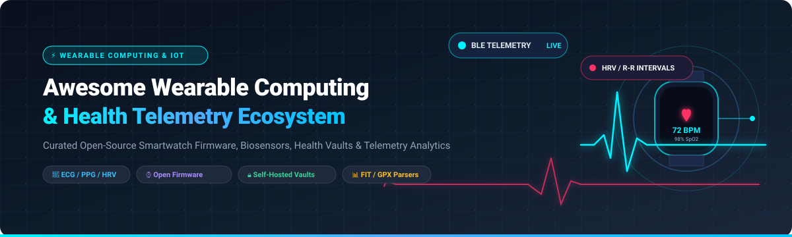

# ⌚ Awesome Wearable Computing & Health Telemetry Ecosystem 💓

  

  
  
  
  
  
  

> **A curated, privacy-first directory of Wearable Computing, Smartwatch Companion Platforms, Biometric Telemetry Ingestion APIs, Open Hardware Biosensors, and Quantified-Self Health Vaults.** 🚀

---

## 📑 Table of Contents
- [🌐 Sector Overview & Market Dynamics](#-sector-overview--market-dynamics)
- [🏢 SaaS & Hosted Telemetry Platforms](#-saas--hosted-telemetry-platforms)
- [💻 Open-Source GitHub Projects](#-open-source-github-projects)
- [🤝 How to Contribute](#-how-to-contribute)
- [💖 Support](#-support)
- [⭐ Star History](#-star-history)
- [⚖️ Disclaimer](#️-disclaimer)

---

## 🌐 Sector Overview & Market Dynamics

The global wearable computing and digital health telemetry market is estimated at **$75–85 billion** as of 2026, projected to exceed **$180 billion by 2032** at an annual growth rate (CAGR) of ~15–18%. 

The market dynamics exhibit **moderate fragmentation with strong platform concentration at the OS and cloud aggregation layers**:
- **Ecosystem Concentration (Winner-Take-Most Core)**: Apple and Google (Alphabet) dominate the mass-consumer and operating system tiers via watchOS/HealthKit and Wear OS/Health Connect.
- **High-Performance Specialization**: Brands like Garmin, WHOOP, and Oura maintain defensible moats around high-accuracy PPG/ECG sensing, recovery algorithms, endurance training load analytics, and discrete form factors (e.g., smart rings).
- **Federated & Open-Source Shift**: A burgeoning open-source and self-hosted ecosystem is rapidly expanding to dismantle vendor lock-in, enabling users and clinical researchers to retain local ownership over sensitive biometric streams, raw R-R intervals, and continuous FIT/GPX logs.

---

## 🏢 SaaS & Hosted Telemetry Platforms

The following hosted and cloud-native telemetry platforms ingest, synchronize, and analyze health metrics from smartwatches, fitness trackers, and biometric peripherals. Sorted descending by company size (market valuation / revenue).

| 🏢 Platform | 📝 Overview & Telemetry Focus | 💰 Starting Price | 🎁 Free Tier Limits | 📊 Company Size (Valuation / Revenue) |
| :--- | :--- | :--- | :--- | :--- |
| **[Apple Health & Fitness+](https://apple.com)** | On-device and iCloud-encrypted health telemetry hub aggregating Apple Watch vitals, ECG, sleep stages, workouts, and third-party HealthKit records. | **$9.99/mo** (or $79.99/yr for Fitness+) | **Unlimited free forever** for Apple Health app on iOS/watchOS (Fitness+ offers a **30-day free trial**; 3 months free with new Apple Watch purchase). | **~$3.4 Trillion Market Cap** ($391B Annual Revenue) |
| **[Google Health Connect & Fit](https://android.com)** | Android platform API and cloud ecosystem unifying health, sleep, and fitness telemetry across Wear OS watches and third-party wellness apps. | **Free** ($0 API platform layer) | **Unlimited free forever** for core Google Fit app and Health Connect sync across Android/Wear OS devices without storage limits. | **~$2.1 Trillion Market Cap** ($307B Annual Revenue via Alphabet) |
| **[Fitbit Premium](https://fitbit.com)** | Cloud health and activity tracking ecosystem monitoring daily steps, heart rate zones, sleep profiles, and stress management metrics. | **$9.99/mo** (or $79.99/yr) | **Unlimited free forever** for basic activity tracking, live heart rate, and basic sleep logs; includes a **90-day free trial** of Fitbit Premium for new device owners. | **Part of Alphabet / Google** (~$2.1B acquisition valuation) |
| **[Garmin Connect](https://garmin.com)** | Comprehensive cloud fitness and health telemetry platform syncing GPS activities, HRV status, Body Battery, sleep scores, and training readiness from Garmin wearables. | **Free** ($0 with hardware purchase) | **Unlimited free forever** full platform access, unlimited activity uploads, reports, and course creation for all Garmin device owners without subscription fees. | **~$40 Billion Market Cap** (~$5.2B Annual Revenue) |
| **[Strava](https://strava.com)** | Social fitness tracking and GPS telemetry platform aggregating workouts from virtually all wearable hardware vendors with segment and power analytics. | **$11.99/mo** (or $79.99/yr) | **Unlimited free forever** for activity recording, GPS tracking, standard beacon sharing, and social feed; includes a **30-day free trial** for Premium features. | **~$2.2 Billion Valuation** (~$275M Annual Revenue) |
| **[WHOOP](https://whoop.com)** | Subscription wearable and cloud analytics platform tracking continuous heart rate variability (HRV), recovery, daily strain, and sleep coaching. | **$30.00/mo** (or $239/yr upfront) | **30-day free trial** with complimentary WHOOP 4.0 hardware band (requires return of device if canceled before 30 days). | **~$3.6 Billion Valuation** (~$150M Annual Revenue) |
| **[Oura Ring & Cloud](https://ouraring.com)** | Smart ring health telemetry platform delivering readiness scores, sleep architecture staging, skin temperature trends, and REST API webhooks. | **$5.99/mo** (or $69.99/yr) | **30-day free trial** included with new Oura Ring purchase; fallback free tier allows single-day readiness/sleep scores without historical trend graphs. | **~$2.55 Billion Valuation** (~$250M Annual Revenue) |
| **[Withings App](https://withings.com)** | Connected health ecosystem aggregating hybrid smartwatch ECG/SpO2 metrics, smart scale body composition, and blood pressure monitor readings. | **$9.95/mo** (or $99.50/yr for Withings+) | **Unlimited free forever** for vital reading sync, weight graphs, basic sleep, and ECG telemetry; includes a **30-day free trial** for Withings+ health improvement programs. | **~$400 Million Valuation** (~$120M Annual Revenue) |
| **[Polar Flow](https://polar.com)** | Sports science and training analytics web/mobile platform pairing with Polar watches and H10 chest straps for detailed cardiac and load telemetry. | **Free** ($0 with Polar hardware) | **Unlimited free forever** for Polar device owners including full training history, Polar Running Program, cardio load, and Sleep Plus Stages analysis. | **~$150 Million Valuation** (~$80M Annual Revenue) |
| **[Suunto App](https://suunto.com)** | Outdoor adventure and multisport wearable platform offering 3D route heatmaps, training load recovery analytics, and third-party sports integrations. | **Free** ($0 core app) | **Unlimited free forever** for route planning, sport logs, heatmaps, and cloud sync; partner integrations provide **30-day free trial** options for SuuntoPlus features. | **~$120 Million Valuation** (~$60M Annual Revenue via Liesheng) |
| **[Terra API](https://tryterra.co)** | Unified cloud wearable telemetry API connecting developers to Garmin, Apple Health, Fitbit, Oura, WHOOP, Polar, and Suunto data streams. | **$120.00/mo** (Starter Tier) | **14-day free trial** with access to sandbox endpoints and up to 10 live connected test wearable user accounts. | **~$50 Million Valuation** (Series A VC-backed) |
| **[COROS Training Hub](https://coros.com)** | Cloud endurance coaching and telemetry analysis portal visualizing EvoLab fitness metrics, GPS routes, and structured workout plans. | **Free** ($0 with COROS hardware) | **Unlimited free forever** complete web analytics dashboard, calendar planning, training load tracking, and EvoLab metrics for all COROS watch users. | **~$45 Million Valuation** (~$35M Annual Revenue) |

---

## 💻 Open-Source GitHub Projects

Explore verified open-source companion apps, custom smartwatch firmwares, self-hosted health telemetry databases, and biometric signal processing toolkits. Sorted descending by GitHub star count. ⭐

- **[Gadgetbridge](https://github.com/Freeyourgadget/Gadgetbridge)**   
  Android companion app for Pebble, Mi Band, Amazfit, PineTime, and Bangle.js supporting offline telemetry.

- **[Wanderer](https://github.com/Flomp/wanderer)**   
  Self-hosted trail database and wearable GPS/biometric activity archive built with Go, SvelteKit, and PocketBase.

- **[ZSWatch](https://github.com/ZSWatch/ZSWatch)**   
  Open-source Zephyr RTOS-based Nordic nRF5340 dual-core smartwatch with BLE telemetry and Gadgetbridge integration.

- **[InfiniTime](https://github.com/InfiniTimeOrg/InfiniTime)**   
  Modern C++ open-source smartwatch firmware for Pine64 PineTime with BLE heart rate and activity metrics.

- **[GarminDB](https://github.com/tcgoetz/GarminDB)**   
  Python tools for downloading and syncing Garmin Connect telemetry, sleep, RHR, and FIT files into local SQLite DB.

- **[python-garminconnect](https://github.com/cyberjunky/python-garminconnect)**   
  Python API wrapper for programmatically retrieving biometric telemetry, HRV, sleep, and workouts from Garmin Connect.

- **[Watchy](https://github.com/sqfmi/Watchy)**   
  Open-source E-Ink ESP32 smartwatch platform with customizable Arduino/C++ firmware and sensor telemetry.

- **[Open Wearables](https://github.com/the-momentum/open-wearables)**   
  Self-hosted unified wearable telemetry platform and developer API aggregating Garmin, Apple Health, and WHOOP.

- **[openScale](https://github.com/oliexdev/openScale)**   
  Android open-source health and body composition logging app for BLE smart scales and diagnostic monitors.

- **[NeuroKit2](https://github.com/neuropsychology/NeuroKit)**   
  Comprehensive Python toolbox for neurophysiological and wearable biosignal processing (ECG, PPG, EDA, EMG, HRV).

- **[Endurain](https://github.com/joaovitoriasilva/endurain)**   
  Self-hosted fitness tracking dashboard syncing telemetry, activities, and metrics from Garmin Connect and Strava.

- **[GoldenCheetah](https://github.com/GoldenCheetah/GoldenCheetah)**   
  Desktop performance analysis and physiological telemetry software parsing FIT, TCX, and GPX files.

- **[BrainFlow](https://github.com/brainflow-dev/brainflow)**   
  C++/Python/Rust biosensor data acquisition library for EEG, EMG, ECG, and PPG wearable telemetry.

- **[OpenTracks](https://github.com/OpenTracksApp/OpenTracks)**   
  Privacy-respecting open-source Android sport and GPS activity tracker supporting Bluetooth LE sensors (heart rate, cadence, power).

- **[FitTrackee](https://github.com/SamR1/FitTrackee)**   
  Self-hosted outdoor workout and biometric telemetry tracker built with Python and React for private GPX/activity storage.

- **[HeartPy](https://github.com/paulvangentcom/heartrate_analysis_python)**   
  Python Heart Rate Variability (HRV) and PPG/ECG signal analysis toolkit designed for wearable sensor data.

- **[AsteroidOS](https://github.com/AsteroidOS/asteroid)**   
  Open-source Linux operating system for smartwatches built with Qt/Wayland and embedded sensor drivers.

- **[Wasp-os](https://github.com/daniel-thompson/wasp-os)**   
  MicroPython-based operating system and firmware for Nordic nRF52832 / nRF52840 smartwatches like PineTime.

- **[python-fitparse](https://github.com/dtcooper/python-fitparse)**   
  Python library to parse ANT+/Garmin FIT telemetry files from fitness and wearable devices.

- **[HA-Garmin-Connect](https://github.com/cyberjunky/home-assistant-garmin_connect)**   
  Home Assistant integration component exposing health, HRV, sleep, and daily metrics from Garmin Connect.

- **[Apple-Health-Grafana](https://github.com/k0rventen/apple-health-grafana)**   
  Self-hosted Dockerized pipeline parsing Apple Health export XML/JSON into InfluxDB and Grafana telemetry dashboards.

- **[BangleApps](https://github.com/espruino/BangleApps)**   
  Modular JavaScript open-source smartwatch application ecosystem and firmware loader for Bangle.js.

- **[GarminExport](https://github.com/petergardfjall/garminexport)**   
  Open-source command-line backup tool and exporter for Garmin Connect health telemetry and activity records.

- **[garmin-connect-export](https://github.com/pe-st/garmin-connect-export)**   
  Automated Python utility to download daily biometric stats, health summaries, and GPX/FIT records from Garmin Connect.

- **[AppleHealth-Analyzer](https://github.com/krumjahn/applehealth)**   
  Privacy-first Apple Health export telemetry analyzer supporting CSV/JSON exports, interactive charts, and local AI queries.

- **[HealthLog](https://github.com/MBombeck/HealthLog)**   
  Self-hosted quantified-self dashboard synchronizing Apple Health, Garmin, and Oura Ring biometric metrics.

- **[fitdecode](https://github.com/polyvertex/fitdecode)**   
  Modern Python library for parsing and decoding Garmin FIT telemetry streams and sensor files.

- **[HealthyPi-v4](https://github.com/protocentral/protocentral_healthypi_v4)**   
  Open-source vital-signs monitoring hardware and firmware capturing ECG, PPG/SpO2, and body temperature telemetry.

---

## 🤝 How to Contribute

Contributions are warmly encouraged! To propose a new SaaS platform, open-source repository, or biometric parser:
1. 🍴 Fork this repository.
2. 🌿 Create a descriptive feature branch (`git checkout -b add-wearable-project`).
3. ✍️ Add the product or repository to the respective section in sorted order.
4. 📝 Ensure official links, factual pricing, and valid GitHub URLs are provided.
5. 🚀 Open a Pull Request with a short summary of the addition!

---

## 💖 Support

Thank you for exploring and using this curated directory! If you find this repository valuable, please consider supporting the project:
- 🌟 **Star this repository** to help others discover it.
- 🍴 **Fork and contribute** your favorite wearable projects, sensors, or biometric telemetry parsers.
- 📢 **Share** with health-tech developers, sports scientists, and quantified-self communities.
- ☕ **Buy me a coffee**: Support ongoing maintenance and open-source curation on the [GitHub Sponsors Dashboard](https://github.com/sponsors/ishandutta2007).

---

##  Star History

---

## ⚖️ Disclaimer

*This list is for educational, research, and informational purposes only. Trademarks and brand names (e.g., Apple, Google, Garmin, Oura, WHOOP, Polar, Withings, Fitbit, Strava) belong to their respective owners. Neither this repository nor its contributors provide medical diagnosis, treatment, or clinical advice.*
